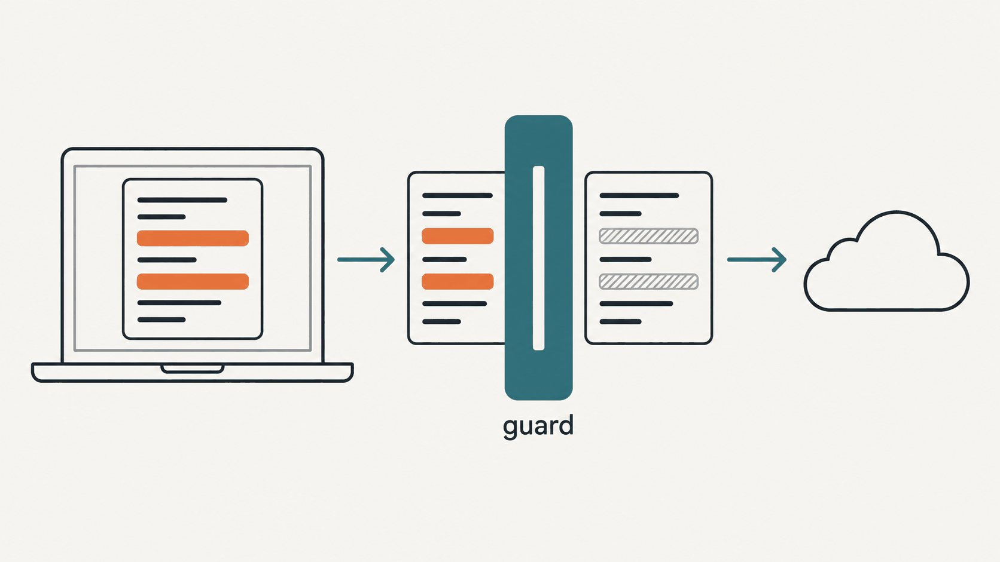
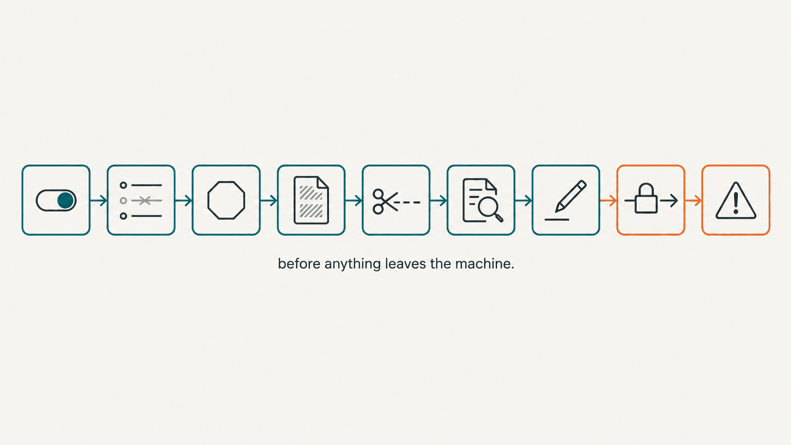

[English](README.md) | **한국어**

# jev-hook-guard — 판정 API로 보내기 전 검사



**Claude Code 훅이 바깥 판정 API에 글을 보내기 전에 거쳐야 할 검사.**

원격 모델에게 판정을 묻는 Claude Code 훅(TypeSafe Jev의 `/v1/systemone`이든 다른 HTTP 판정 API든)은 세션의 글을 내 컴퓨터 밖으로 보낸다. 방금 친 프롬프트, 도구 호출, 어시스턴트의 마지막 메시지 같은 것들이다. 그 글에는 API 키, 전화번호, 거래처 이름, 파일 경로가 섞여 있다. `jev_hook_guard.py`는 그 전송 바로 앞에서 도는 표준 라이브러리 파이썬 모듈 하나다. 내가 적어 둔 주제에 닿은 세션은 멈추고, 비밀값을 통째로 붙여 넣은 것 같은 입력은 아예 안 보내고, 남은 글은 가리고, 결과를 한 번 더 검사한 뒤, 리다이렉트를 따라가지 않고 시간 상한을 걸어 보낸다. 훅이 고장 나도 세션을 막지 않게 하는 래퍼 스크립트도 같이 있다. Claude Code 훅이나 에이전트 옆에서 도는 보조 프로세스가 판정 API를 부른다면 누구에게나 필요한 층이다. 보장은 아니다. 정규식 규칙을 전송 직전 마지막 단계로 적용하는 것이고, 독립 검토 두 번에서 나온 공격 사례 52개로 시험했으며, 새로운 종류의 비밀값에는 새 규칙이 필요하다.

## 무엇이 밖으로 나가고, 무엇이 절대 안 나가나

| 항목 | 가는 곳 |
|---|---|
| 가린 글, 최대 `limit`자(기본 600자) | 내가 정한 엔드포인트 |
| 내가 쓴 질문 문구와 모델 이름 | 내가 정한 엔드포인트 |
| API 키 | `Authorization` 헤더에만, https 엔드포인트(또는 127.0.0.1·localhost·[::1]의 http)로만. 리다이렉트 뒤 다른 호스트로는 절대 안 간다 |
| 가리기 전 글 전부: 프롬프트, 도구 입력, 도구 결과 | 안 나간다 |
| 사용자 글·어시스턴트 글·작업 폴더·기록 경로에서 제외 낱말이 걸린 세션의 이후 글 | 안 나간다. 그 세션이 끝날 때까지 |
| 비밀값을 붙여 넣은 것 같은 입력: URL 자격증명, 비밀 라벨 낱말, `이름=값` 두 줄 이상, 도로명 주소 | 안 나간다. 통째로 거절 |
| env 파일에서 6자 이상인 값(한계 참고), 그 앞 12자나 뒤 12자, 그리고 이것들이 들어 있는 토큰 전체 | 안 나간다. `<redacted>` |
| 키·토큰 모양, 전화번호, 주민·외국인등록번호, 카드·계좌번호, 이메일, 님·씨가 붙은 한국 이름, 내 이름, 홈 경로 | 안 나간다. `<redacted>` `<phone>` `<id-number>` `<card>` `<account>` `<email>` `<hash>` `<name>` `~` |
| 보내기 전 기록 줄을 못 쓰거나 고정 표식 폴더에 쓸 수 없을 때의 모든 것 | 안 나간다 |
| 로그 | 디스크에 남는다. 파일 0600, 폴더 0700. 예제 훅은 상태와 가린 글 앞 120자만 남기고 원문은 남기지 않는다 |

## 무슨 일을 어떤 순서로 하나



1. **끄기 파일.** 훅은 맨 먼저 `OFF` 파일을 보고 있으면 바로 끝낸다. 기록도 네트워크도 없다.
2. **제외 낱말.** `Exclude`가 파일에서 한 줄에 하나씩 패턴을 읽어, 정규화한 글과 띄어쓰기를 다 지운 글에 한 번씩 맞춰 본다. 걸리면 `SessionPins`로 그 세션을 고정한다.
3. **통째 거절.** `refuse()`는 비밀값을 붙여 넣은 것 같은 입력(URL 자격증명, 비밀 라벨, 붙여 넣은 `.env` 파일, 도로명 주소)이면 아무것도 보내지 않게 한다.
4. **가림.** `mask()`가 env 파일 값, 키·토큰 모양, 개인정보, 라벨 뒤의 값, 이름, 홈 경로를 바꿔 쓴다.
5. **자르기.** `mask()`는 다 가린 다음에 `limit`자로 자른다. 그래서 잘린 끝에 키 반쪽이 남지 않는다.
6. **마지막 검사.** `leftover()`가 실제로 보낼 글에 env 값, 키, 라벨 뒤의 값, 전화·주민·카드·계좌번호, 긴 토큰 규칙을 한 번 더 돌린다. 하나라도 걸리면 안 보낸다.
7. **보내기 전 기록.** `append_jsonl()`로 pending 줄을 먼저 쓴다. 이걸 못 쓰면 안 보낸다.
8. **전송.** `post_json()`은 https로만 보내고(http는 루프백만), 3xx는 하나도 따라가지 않고, 벽시계 기준 시간 상한에서 끊는다.
9. **오류 분류.** `classify_error()`가 실패를 `timeout`, `billing`(402), `redirect-refused`, `auth-error`, `rate-limited`, `http-error`, `network`로 나눈다. 예제 훅은 402를 오류 로그에도 따로 남긴다. 크레딧이 떨어져 대답을 못 하는 판정기는 겉으로는 「아니다」라고 대답하는 판정기와 구별이 안 되기 때문이다.

## 규칙마다 있는 이유

이 규칙들은 TypeSafe Jev에 글을 보내는 비공개 훅 두 개(프롬프트 훅, Stop 훅)와 그 훅들에 대한 독립 검토에서 나왔다.

- **앞뒤 12자가 아니라 토큰 전체를 가린다.** 예전에는 알고 있는 자격증명을 앞 12자와 뒤 12자로만 가렸다. 실제 값에 돌려 보니 19개 항목에서 가운데 7~8자가 남았고, 마지막 검사도 그걸 통과시켰다. 지금은 알려진 값에 닿은 토큰을 통째로 바꾼다.
- **공격 사례 52개.** 독립 검토 두 번이 가림을 뚫으려고 만든 입력을 26개씩 내놨다. 줄을 바꾸거나 4자씩 띄어 쪼갠 키, 전각·키릴 문자로 바꾼 키, `+82 (0)`나 슬래시를 쓴 전화번호, 띄어 쓴 카드·계좌번호, 외국인등록번호, `P/W`와 띄어 쓴 「비 번」, `at`·`dot`로 쓴 이메일, `@` 뒤 공백, 숫자 없는 쿼리 값 같은 것들이다. 고치기 전에는 두 번째 묶음의 12가지 모양이 프롬프트 훅이 보내는 다섯 군데 모두에서 샜다. 130번 중 60번이다. 지금은 모든 사례가 거절되거나 가려지고, 시험이 52개를 전부 본다.
- **세션 고정은 어디서 걸렸는지에 따라 정한다.** 도구 결과에 제외 낱말과 같은 파일 이름이 한 번 찍혔다는 이유로 세션 전체가 고정돼 그 뒤로 한 번도 판정되지 않은 일이 있었다. 지금은 사용자 글, 어시스턴트 글, 작업 폴더, 기록 경로에서 걸릴 때만 세션을 고정한다. 도구 입력·도구 결과·첨부·기록 끝부분에서만 걸리면 그 한 번만 건너뛴다.
- **고정은 영구다.** 제외 주제에 닿은 세션을 다음 날 다시 열었을 때 전송이 되살아나면 안 된다. 그래서 고정 표식 파일은 지우지 않는다.
- **종료 코드 0 래퍼.** Claude Code는 훅의 종료 코드 2를 「막아라」로 읽는다. `UserPromptSubmit`에서는 프롬프트를 막고 지워 버리고, `Stop`에서는 세션을 억지로 계속 돌린다. `.py` 파일이 없으면 `python3`가 2로 끝나므로, 파일 하나를 옮기는 것만으로 모든 세션의 모든 프롬프트가 막힐 수 있다. 래퍼는 무엇이 일어나든 0으로 끝나고 실제 코드를 로그에 남긴다.
- **리다이렉트를 따라가지 않는다.** 3xx를 따라가면 `Authorization` 헤더가 리다이렉트가 가리키는 아무 호스트로나 간다.
- **보내기 전에 먼저 기록한다.** 전송 도중 프로세스가 죽어도 무언가 나가려 했다는 흔적이 남고, 기록을 못 쓰면 아무것도 나가지 않는다.
- **패턴의 구분자.** 하이픈으로만 쓴 패턴은 하이픈만 잡았고, 띄어 쓰거나 밑줄을 쓰거나 붙여 쓴 표기는 그대로 나갔다. `client[-_ ]?x`처럼 쓴다. 맞춰 보기도 띄어쓰기를 다 지운 글에 한 번 더 한다.

## 설치와 사용

설치할 패키지는 없다. 저장소를 클론하거나(`git clone https://github.com/tsetse012/jev-hook-guard`) `jev_hook_guard.py`를 훅 스크립트 옆에 복사하면 된다. 파이썬 3.9 이상, 표준 라이브러리만 쓴다.

```python
import os, jev_hook_guard as g

pins = g.SessionPins(os.path.expanduser("~/.my-hook/pinned"))
ex = g.Exclude(os.path.expanduser("~/.my-hook/exclude.txt"))
if pins.pinned(sid) or not pins.writable():
    return
if ex.hit(cwd) or ex.hit(prompt):
    pins.pin(sid, "cwd" if ex.hit(cwd) else "user")
    return
if g.refuse(prompt):
    return
env = g.load_env_values(os.path.expanduser("~/.my-hook/mask.env"))   # 예: 내 자격증명 파일
text = g.mask(prompt, env, limit=600, self_names=["홍길동", "gildong"])
if not text or g.leftover(text, env):
    return
g.append_jsonl(log_path, {"status": "pending", "head": text[:120]})
try:
    resp, ms = g.post_json(url, {"model": "jev-1.13.0", "state": {"prompt": text}, "questions": questions}, key, 2.5)
except Exception as e:
    status, extra = g.classify_error(e)
```

`hooks/example_prompt_hook.py`가 이 순서대로 만든 완성된 `UserPromptSubmit` 훅이다. Jev에게 질문 하나(이 프롬프트가 되돌리기 어려운 일을 시키나?)를 묻고, 기본값인 섀도 모드에서는 로그만 남긴다. settings.json에는 파이썬 파일이 아니라 래퍼를 등록한다(`hooks/settings.snippet.json`).

```json
{"hooks": {"UserPromptSubmit": [{"hooks": [{"type": "command",
  "command": "/ABSOLUTE/PATH/TO/jev-hook-guard/hooks/wrapper.sh", "timeout": 5}]}]}}
```

예제 설정은 전부 환경변수다. 훅이 읽는 것은 `TYPESAFE_API_KEY`(없으면 `no-key`만 남기고 아무것도 보내지 않는다), 판정 API 주소 `JHG_ENDPOINT`(기본 `https://api.typesafe.ai/v1/systemone`, https 또는 루프백의 http만), 가릴 값이 든 파일 `JHG_ENV_FILE`, 제외 파일 `JHG_EXCLUDE`(기본은 상태 폴더의 `exclude.txt`, `examples/exclude.txt` 참고), 쉼표로 나눈 내 이름 `JHG_SELF_NAMES`, 세션에 알림 줄을 찍게 하는 `JHG_SHADOW=0`, 상태 폴더 `JHG_STATE_DIR`(기본 `~/.jev-hook-guard/`, 안에 `decisions.jsonl`, `error.log`, `pinned/`가 남는다)이다. 래퍼가 읽는 것은 인터프리터 `JHG_PYTHON`(기본 `/usr/bin/python3`. 그 경로가 없으면 훅은 아무 일도 하지 않고 래퍼가 `error.log`에 `wrapper python rc=127`을 남긴다)과 훅 파일 `JHG_HOOK_PY`(기본은 래퍼 옆의 `example_prompt_hook.py`)다.

끄기: `mkdir -p ~/.jev-hook-guard && touch ~/.jev-hook-guard/OFF`(폴더는 훅이 처음 돈 뒤에야 생기므로 먼저 만든다). 훅은 프롬프트를 읽기 전에 멈춘다. 파일을 지우면 다시 돈다.

## 다루는 범위

영어와 한국어 모양을 정규화한 뒤에 맞춘다(전각 문자를 보통 문자로, 폭 없는 글자 제거, NFC, 대시 변형 통일, 라틴 문자와 똑같이 생긴 키릴·그리스 문자를 라틴으로).

- 키와 토큰: `sk-`(OpenAI, Anthropic), `sk_live_`·`rk_test_`(Stripe), `ghp_` `gho_` `ghu_` `ghs_` `ghr_` `github_pat_`, Slack 토큰(`xoxa` `xoxb` `xoxo` `xoxp` `xoxr` `xoxs`), `AKIA`(AWS), `AIza`(Google), `sb_secret_`·`sbp_`(Supabase), `npm_`, 텔레그램 봇 토큰, JWT, PEM 개인키, `Authorization:`와 `Bearer`, HTTP Basic·Digest, 4자씩 띄어 쓴 키, 글자와 숫자가 섞인 8자 이상 토큰.
- 대입: 이름이 `KEY`·`TOKEN`·`SECRET`·`PASSWORD`·`PASS`·`PWD`로 끝나고 `=`나 `:`가 붙은 것, JSON 필드, `.env` 줄, 이름에 `session`·`sid`·`auth`·`sign`·`cred`가 든 설정.
- URL 자격증명: `scheme://user:pw@host`, 스킴 없는 `user:pw@host`, 이름이 `key`·`token`·`auth`·`sig`·`pass`·`pw`·`secret`인 쿼리 값, 그 밖에 대소문자가 섞인 12자 이상 쿼리 값.
- 라벨 뒤의 값: password, passwd, passphrase, pwd, P/W, pass, api key, token, secret, auth, otp, pin과 한국어 비번, 비 번, 비밀번호, 암호, 패스워드, 인증번호, 시크릿, 키체인, ○○키, 토큰. `비번은` 다음 줄에 적은 값까지.
- 전화번호: 하이픈·점·슬래시·공백으로 나눈 휴대폰·지역번호, `+82 10`, `+82 (0)10`, `(02) 1234-5678`.
- 주민등록번호와 외국인등록번호(앞 여섯 자리가 날짜일 때).
- 카드번호(구분자와 상관없이 4-4-4-4, 아멕스 4-6-5)와 계좌번호(국내 은행 배열, 애매한 배열은 근처에 은행 낱말이 있어야).
- 이메일: `name at example dot com`, `name at example.com`, `@` 뒤 공백까지.
- 커밋 해시와 16진 id, env 파일에서 6자 이상인 값(통째로, 공백·줄바꿈으로 쪼갠 것, 앞 12자나 뒤 12자), 님·씨 앞의 한국 이름, 내 이름, 홈 경로.
- 통째 거절: URL 자격증명, 대소문자와 상관없이 password·passwd·passphrase·secret·token·credential·api key라는 낱말(더 긴 낱말 안에 있어도. 예: tokens, apikey, api_key), 홀로 쓴 pw와 P/W, `pass is`, 한국어 비번(띄어 쓴 비 번 포함)·비밀번호·암호·인증키·패스워드, `이름=값` 두 줄 이상, 국내 도로명 주소와 아파트 동·호수. 위의 다른 라벨 낱말(pwd, pass, auth, otp, pin, 인증번호, 시크릿, 키체인, 그 밖의 ○○키, 토큰)은 입력을 거절하지 않고 옆의 값만 가린다.

## 한계

- 새로운 종류의 데이터에는 새 규칙이 필요하다. 모양도 라벨도 없는 비밀값(평범한 낱말로 된 암구호, 국외 주소, 님·씨 없는 이름)은 모양 규칙을 그대로 통과한다. 그런 낱말은 제외 파일에 넣거나, 값을 env 파일에 넣는다.
- 가림은 일부러 많이 잃는다. 해시, 긴 토큰, 숫자가 섞인 경로, 계좌처럼 생긴 숫자는 자리표시로 바뀌고, 비밀번호나 토큰을 언급한 입력은 아예 안 나간다. 판정기는 내가 친 것보다 적게 본다.
- env 파일에서 6자보다 짧은 값(`load_env_values()`의 `min_len`)은 읽지 않으므로 가려지지 않는다. `true`, `false`, `8080` 같은 짧은 값까지 읽으면 글 곳곳의 같은 낱말과 숫자가 모두 가려지기 때문이다. 짧은 비밀값은 라벨이나 모양 규칙에 걸릴 때만 가려진다. 그만큼 더 가려져도 괜찮다면 `min_len`을 낮춰서 넘긴다.
- 세션 고정은 영구다. 잘못 고정됐으면 `pinned/` 아래 그 파일을 손으로 지운다.
- 문턱값과는 상관이 없다. 이 모듈은 판정을 하지 않는다. 무엇을 물을지, 어떤 모델을 쓸지, 몇 이상을 「움직여라」로 볼지는 훅이 정한다. 예제의 0.7은 보기일 뿐이다.
- 정규식 기반이고 전송 직전 마지막 단계에서 돈다. 데이터 유출 방지 제품을 대신하지 못한다. 훅이 실제로 보낸 것이 무엇인지는 로그로 확인한다.
- 0.1.1에서 알려진 빈틈(최종 모듈에서 실측): `pwd =`·`pass:`·`pw는` 뒤에 여러 낱말로 된 값이 오면 첫 낱말만 가린다(`passphrase`는 통째로 거부하지만 이 라벨들은 아니다). `핀번호 7391`은 `핀번호`가 라벨 낱말이 아니라 안 가린다. 한글 낱말에 바로 붙은 글자만의 토큰(`값은bearer abcdefghijklmnop`)은 `bearer`·`basic` 규칙이 아직 `\b`를 써서 안 가린다. 다음 판이 덮기 전까지는 그런 낱말을 제외 파일이나 env 파일에 넣는다.

## 시험

```bash
python3 -m unittest discover -s tests -v
```

시험 89개, 네트워크는 쓰지 않는다. 요청은 루프백 목 서버나 바꿔 끼운 오프너로 간다. 공격 사례 52개(검토마다 26개, 입력마다 거절되거나 값의 조각이 남지 않아야 한다. 조각 기준은 숫자면 7자리, 그 밖엔 6자), 그대로 돌아와야 하는 대조군 19개(날짜, 버전, 시험 결과, 포트, 가격, 모델 이름, 계정 핸들, 파일 이름), 한글에 붙여 쓴 번호와 키, 라벨 뒤의 값, 예제 훅 전 과정(빈 입력, 키 없음, 402, 리다이렉트, 시간 상한, 섀도·라이브 출력, 내 이름), 세션 고정, 파일 권한, 로그 회전, 래퍼 종료 코드를 본다. 파이썬 3.9와 최신 파이썬 3 둘 다에서 돈다.

## 라이선스

MIT
